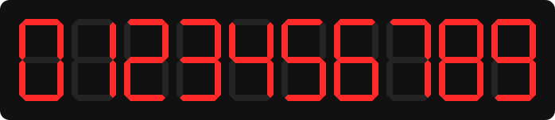
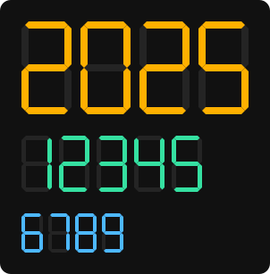

<h1 align="center">A Seven Segment Display Component for ReactJS</h1>

<p align="center">
  
</p>

Renders a single digit (0-9) as an inline SVG. Written in TypeScript, ships ESM + CJS builds with type definitions. Works with React 18 and 19.

### Installation

```
npm install react-seven-segment-display
```

### Usage

```tsx
import { SevenSegmentDisplay } from 'react-seven-segment-display';

<SevenSegmentDisplay value={7} width={40} height={10} />
```

A default export is also available. For multi-digit numbers, render one component per digit:

```tsx
{String(1234).split('').map((d, i) => <SevenSegmentDisplay key={i} value={d} />)}
```

### Examples

<p align="center">
  
</p>

```tsx
<SevenSegmentDisplay value={4} onColor="#ffb000" offColor="rgba(255,255,255,0.08)" />
```

### Props

| Prop | Type | Default | Description |
| --- | --- | --- | --- |
| `value` | `number \| string` | `0` | Digit from 0 to 9. Anything else throws a `RangeError`. |
| `width` | `number \| string` | `40` | Length of a segment, in px. |
| `height` | `number \| string` | `5` | Thickness of a segment, in px. |
| `onColor` | `string` | `'rgba(255,0,0,1)'` | Colour of lit segments. |
| `offColor` | `string` | `'transparent'` | Colour of unlit segments. |

Any other prop (`style`, `className`, `aria-*`, ...) is passed to the root `<svg>`. The overall size is `(width + 2 * height)` by `(2 * width + 3 * height)` px; to scale it, set `style={{ width, height }}` (the `viewBox` keeps proportions).

### Migrating from 2.x

- The standalone `dist/react-seven-segment-display.min.js` UMD bundle and the `window.reactSevenSegmentDisplay` global are gone. Use a bundler or an ESM-aware CDN.
- The component now renders an `<svg>` rather than nested `<div>`s, and `style` no longer mutates the object you pass in.
- `value` must be an integer 0-9; anything else throws a `RangeError` (previously invalid values crashed with a confusing error).
- React 18+ is required.

### Development

```
npm run dev        # playground at http://localhost:5173
npm test           # vitest
npm run typecheck
npm run build      # outputs dist/
npm run images     # regenerates the SVGs in docs/ from the built component
```
